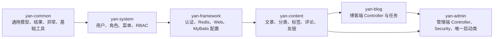

# YanBlog 当前架构

## 模块边界

依赖方向保持单向。`yan-admin` 是唯一 Spring Boot 可执行模块，其他模块均为普通 JAR，不再各自创建 Application、数据源或安全上下文。

## 运行入口

- 后端：`yan-admin`，端口 `8989`。
- 博客前端开发服务：`frond/sg-blog-vue`，端口 `8080`，`/api` 代理到后端。
- 管理前端开发服务：`frond/sg-vue-admin`，端口 `81`，`/dev-api` 代理到后端。
- MySQL、Redis 使用现有实例，不由项目启动 Docker Compose。

## API 边界

- 博客端：`/api/blog/**`。
- 管理端：`/api/admin/**`。
- 旧的 `/article/**`、`/content/**`、`/system/**` 等路径暂时作为兼容接口保留，前端已切换到新路径。

认证 Token 使用 `scope` 区分 `blog` 和 `admin`，Redis 会话键统一为 `login:{scope}:{userId}`。博客 Token 请求管理接口返回 HTTP 403；未登录或会话失效返回 HTTP 401。

## 登录跳转

- 前台只保护个人中心等需要身份的页面；未登录时跳到 `/Login?login=1&redirect=...`，成功后返回原页面。
- 后台所有业务页默认需要登录；未登录时跳到 `/login?redirect=...`，成功后恢复目标路由。
- 两端使用不同 Cookie：`user-Token` 与 `Admin-Token`，互不覆盖。

## 浏览量计数

- `ArticleCounterService` 统一封装浏览量读取、增长、初始化和落库，不再由文章服务、启动器和定时任务分别操作 Redis。
- Redis Hash `blog:article:view-count` 保存当前计数，Set `blog:article:view-count:dirty` 只记录待落库文章，Set `blog:article:view-count:published` 限制只有已发布文章可以计数。
- Lua 脚本在一次 Redis 操作中完成发布状态检查、访问指纹防重、`HINCRBY` 与 `SADD`；同一 IP 与 User-Agent 生成的指纹在 30 分钟内只计一次。
- 定时任务每分钟最多处理 100 个 dirty articleId，使用单条 `CASE WHEN` SQL 批量更新浏览量。数据库成功后，仅当 Redis 当前值仍等于本次快照时才移除 dirty 标记，避免落库期间新增访问丢失。
- 启动初始化使用 `HSETNX`，不会用 MySQL 旧值覆盖 Redis 尚未落库的计数；同时兼容迁移旧的 `article:viewCount` Hash。应用关闭前会尽力执行一次批量刷盘。

## 兼容与后续工作

1. 新功能只新增到 `/api/blog` 或 `/api/admin`，不再扩展旧路径。
2. 前后端稳定运行一轮后，统计旧路径调用并移除兼容映射。
3. 将数据库、Redis、OSS 凭据迁移到环境变量，并补充 `application-example.yml` 与本地运行手册。
4. 生产环境关闭 MyBatis SQL 输出，再进入缓存、计数、搜索与压测阶段。
