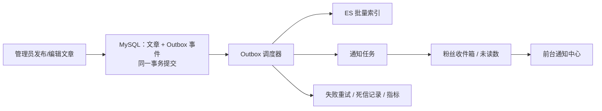

# YanBlog 后续优化路线：可靠内容分发平台

> 制定日期：2026-07-19  
> 当前基础：文章创作、Redis 缓存与浏览量聚合、评论查询优化、Elasticsearch 搜索、后台管理、健康检查与基础 k6 脚本已完成。  
> 调整原则：原 Day 8 的正式压测暂缓；先完成可讲清、可验证的业务闭环，再在稳定版本上统一压测。

## 本轮目标

将项目从“具备搜索的博客”升级为“可靠内容分发平台”。核心不是堆叠中间件，而是解决两类真实问题：

1. **文章变更不能丢**：MySQL 提交成功后，搜索索引最终必须可恢复地追上。
2. **大 V 发文不能压垮系统**：发布主链路快速返回，通知链路异步、可重试、可观测。

本轮保持多模块单体，不急于拆微服务；MySQL 仍是事实来源，Redis/ES/MQ 都是派生能力或加速层。

## 优先执行的三项优化

以下三项按顺序完成，是本轮最能体现后端工程能力、也最适合形成简历亮点的主线。Day 14 的正式压测必须建立在它们的稳定版本上。

| 优先级 | 优化项 | 要解决的问题 | 核心交付 | 完成标准 |
| --- | --- | --- | --- | --- |
| P0 | 事务 Outbox + ES 批量同步 | 本地异步线程在应用崩溃时可能丢失已提交文章的索引事件 | Outbox 表、状态机、批量消费者、指数退避、重放接口 | ES 故障/应用重启后，文章主流程不受阻塞，待处理事件可恢复并最终追平索引 |
| P1 | 关注关系 + 异步发文通知 | 文章发布缺少用户触达；同步通知会随着粉丝数增加拖慢发布 | 关注关系、通知收件箱、未读数、通知分页、异步分批消费与幂等键 | 用户可完成关注、收通知、已读和跳转文章闭环；发布接口不等待全部通知写入 |
| P2 | 大 V 混合扇出 | 向大量粉丝逐条写通知会导致写入量和存储成本线性爆炸 | 粉丝阈值、普通作者写扩散、大 V 读扩散、游标分页、通知去重与降级 | 大 V 发布只新增有限记录，粉丝仍可在通知流读取新文章，且不会重复展示 |

### 推荐实施顺序

1. **先完成 P0**：先让“内容写成功后，搜索一定能补上”这条基础链路可靠。线程池只负责吞吐，Outbox 才负责持久化与恢复。
2. **再完成 P1**：在可靠事件投递基础上增加用户价值，采用异步分批通知，避免把粉丝处理放进发布事务。
3. **最后完成 P2**：以 P1 的收件箱模型为基础，引入阈值和读扩散应对大 V 场景；这是一项架构优化，不承诺未经实测的百万级线上能力。

## 技术主线

## 重新安排后的 7 天执行计划

安排原则：前两天先交付一个可运行的可靠索引闭环，后四天逐步放大“发文通知”业务，最后一天只做基于稳定版本的压测与材料整理。每一天结束时都应有可演示接口、自动化测试和更新后的文档，而不是只完成设计稿。

| 天数 | 当天可演示的闭环 | 主要交付 | 验收重点 |
| --- | --- | --- | --- |
| Day 8（已完成） | 发布文章后，即使 ES 宕机，索引任务也不会因应用重启丢失 | Outbox 表、事务写事件、最小轮询消费者、单篇索引与重放 | 发布成功；ES 恢复后任务可自动完成 |
| Day 9（已完成） | 一次文章变更可批量、幂等地更新 ES，并具备受控重试 | 批量 Bulk 同步、抢占/租约、指数退避、Outbox 成功/失败指标 | 100 条变更可追平；重复消费、应用重启和 ES 超时均安全 |
| Day 10（已完成） | 用户可关注作者，并在前台查看自己的通知中心 | 关注/取关、通知表、通知分页、未读数、已读接口与前端入口 | 不越权、不重复关注，通知可跳转文章详情 |
| Day 11 | 普通作者发文后，粉丝能异步收到通知，发布接口快速返回 | 发文通知事件、游标分批扇出、批量入库、通知幂等 | 发布不等待粉丝处理；失败批次可续跑且不重复通知 |
| Day 12 | 大 V 发文不产生海量同步写入，粉丝仍能读取最新动态 | 粉丝阈值、读扩散作者流、混合通知流合并、去重与游标 | 大 V 写入量受控；个人收件箱与作者流不重复展示 |
| Day 13 | 运维人员可定位、重放并观察任何异步失败任务 | 后台失败任务查询/重放、积压/耗时指标、故障演练与回归测试 | 能定位失败原因和重试历史；重放后状态可验证 |
| Day 14 | 用固定数据和环境，给所有关键结论提供压测证据 | k6 场景、正式性能报告、简历表述与 60 秒讲解 | QPS、P95/P99、错误率、同步时延均可复跑 |

## Day 8：Outbox 最小可靠闭环

状态：已完成（2026-07-19）。

实现记录：新增 `yan_article_search_outbox` 迁移表；文章新增、编辑、删除、上下架及浏览量批量落库均在对应 MySQL 事务内写入事件。定时消费者以 `PENDING → PROCESSING → SUCCEEDED` 状态机逐条投递，使用租约回收中断任务；ES 失败时记录错误、延迟重试，后台 `POST /api/admin/content/search/retry` 可将待处理事件提前重放。当前固定延迟重试和单条消费是 Day 8 的最小闭环，批量 Bulk、指数退避、失败终态和指标留待 Day 9/13。

验证记录：执行迁移后，根目录 `mvnw test` 共 22 个测试、0 失败，其中新增 4 个 Outbox 单元测试覆盖事件持久化、成功投递、失败重试与抢占失败。真实演练中，停止 ES 后更新文章 112 状态仍返回 200；事件在 ES 故障和 YanBlog 重启后持续保存在 MySQL 并重试，恢复 ES 后转为 `SUCCEEDED`，健康检查恢复 `UP`。

### 要做什么

1. 建立 `yan_article_search_outbox` 表，包含事件 ID、文章 ID、状态、重试次数、下次可执行时间、锁过期时间、失败原因、创建与更新时间。
2. 文章发布、编辑、上下架、删除时，在**同一个 MySQL 事务**内写文章数据和 Outbox 事件。
3. 定义状态机：`PENDING → PROCESSING → SUCCEEDED`；Day 8 失败后回到 `PENDING` 延迟重试，失败终态 `FAILED` 留到 Day 13。
4. 实现最小消费者：轮询一条待处理事件，按文章 ID 更新或删除 ES 索引；同步成功后再标记完成。
5. 明确幂等规则：以文章 ID 为索引文档 ID；重复的 upsert 或 delete 必须安全。

### 验收

- 人为停止 ES 后发布文章，文章主流程仍成功，Outbox 中保留待处理事件。
- 应用重启后，未完成事件仍然存在，不依赖 JVM 内存队列；ES 恢复后可由消费者或重放接口完成。
- 有迁移脚本和至少覆盖“提交、失败保留、恢复处理”的自动化测试。

## Day 9：批量同步与失败恢复加固

状态：已完成（2026-07-20）。

实现记录：Outbox 每轮最多拉取 100 条 `PENDING` 事件并逐条条件抢占；按文章 ID 去重、批量读取 MySQL 后，通过一次 Elasticsearch Bulk API 同步 upsert/delete。Bulk 单条失败按文章 ID 分流，只重试失败事件。重试等待改为指数退避 `10s → 20s → 40s`，最大 300 秒；新增 `blog.search.outbox` 成功/失败计数指标。

验证记录：全项目 `mvnw test` 共 22 个测试、0 失败。真实环境以 20 个客户端并发提交 100 条文章状态变更，100 个请求均返回 200，提交耗时 0.828 秒；调度器日志显示分两批完成（30、70），12 秒后 100 条新增 Outbox 事件均为 `SUCCEEDED`，搜索“压测样本文章”仍返回总数 100。

### 要做什么

1. 使用定时拉取 + 原子抢占/租约处理待投递事件；避免多实例或重复调度时重复消费。
2. 按批读取事件，批量读取文章，再通过 Elasticsearch Bulk API 提交 upsert/delete。
3. 成功后标记事件完成；失败按指数退避更新 `next_retry_at`，不忙等。
4. 增加连续变更合并策略，降低同一文章短时间反复编辑造成的无效索引写入。
5. 保留现有“按文章重建 / 全量重建”接口，作为灾难恢复工具，不把它当作日常补偿。
6. 将线程池作为吞吐调优项，而不是可靠性唯一来源：核心/最大线程数、队列长度应配置化并有指标。

### 验收

- 100 个文章变更能批量完成，索引与数据库状态一致。
- 注入 ES 超时或异常时，事件重试次数和下次执行时间正确变化。
- 任务执行中重启应用后，租约过期的任务可被重新处理；重复执行不产生脏索引。

## Day 10：关注与通知中心最小业务闭环

状态：已完成（2026-07-20）。

实现记录：新增迁移 `V20260720__user_follow_and_notification.sql`，创建 `yan_user_follow` 与 `yan_user_notification`。关注关系使用 `(follower_id, followee_id)` 唯一键，服务层预查并捕获并发唯一键冲突，保证重复关注成功且不重复写入；重复取关同样成功。提供关注/粉丝列表、关注状态，通知分页、未读数、单条/全部已读接口。所有通知查询和更新均以当前登录用户 ID 作为 SQL 条件，避免跨用户读取或标记。前台顶部增加登录后可见的通知铃铛和未读角标，通知中心支持空态、分页、全部已读与文章跳转，桌面及移动端均适配。

验证记录：根目录模块回归 `mvnw.cmd -pl yan-content,yan-blog -am test` 共 25 个测试、0 失败；前台 `npm.cmd run build` 成功。真实环境用两个临时普通账号验证重复关注/取关、关注列表、未读数、通知分页、单条已读和跨用户已读保护，全部通过并已清理测试数据；统一后端重启后健康检查为 `UP`。页面在桌面及 390px 移动端验证了铃铛角标、通知列表和“全部标为已读”的状态同步。

边界说明：Day 10 只完成收件箱和权限/交互基础；“文章发布后异步、分批给粉丝写入通知”属于 Day 11，届时会将发文主链路与扇出任务解耦，并补充游标、重试与通知幂等键。

### 要做什么

1. 建立关注关系：用户关注、取关、关注列表、粉丝列表；增加唯一约束，保证重复操作幂等。
2. 建立站内通知模型：通知 ID、接收者、触发者、文章 ID、类型、摘要、已读状态、创建时间。
3. 提供前台接口：通知分页、未读数、单条已读、全部已读。
4. 在前台增加通知入口和未读角标；通知点击可跳转文章详情。
5. 明确权限：只能读取和标记自己的通知。

### 验收

- A 关注 B，B 发布文章后 A 能看到一条可跳转的站内通知。
- 重复关注、重复标记已读不会产生重复数据或错误。
- 通知分页不出现跨用户数据泄漏。

### Day 10 补充：可交互的社交通知闭环（已完成）

### 要做什么

1. 完成关注、文章发布、文章评论和评论回复四类通知；忽略“给自己发通知”的无效事件。
2. 通知记录保存评论 ID 与根评论 ID，支持跳转到文章评论位置、以及在通知中心直接回复。
3. 通知中心显示评论正文、文章标题和事件类型；粉丝通知可以跳转到粉丝主页。
4. 增加通知删除接口，并以当前登录用户为条件限制删除；前台通过右键菜单发起删除确认。
5. 保留未读数、单条/全部已读与分页能力，删除后同步维护前端未读角标。

### 验收

- 已用两个临时用户实际验证：关注 → 发文 → 评论 → 回复，四类通知均写入正确收件箱。
- 已验证通知内回复框、评论跳转上下文、粉丝主页入口和右键删除通知；测试数据已清理。

## Day 11：普通作者的异步通知闭环（已完成基础闭环）

实现记录：文章发布事务内只写入 `yan_notification_outbox` 事件，发布主流程不再同步遍历粉丝。通知消费者按游标 `cursor_follower_id` 分批读取粉丝，批量 `INSERT IGNORE` 写入收件箱；同一文章对同一接收者通过唯一键保证幂等。失败时记录 `last_error`，按指数退避回到 `PENDING`，租约过期任务可被重新领取。

### 要做什么

1. 将“文章发布”与“生成粉丝通知”拆开：文章提交成功后只记录事件，通知由异步消费者处理。
2. 为普通作者采用**写扩散（fan-out on write）**：分批查询粉丝并批量插入通知。
3. 采用游标分页而非大 offset，控制每批大小，避免一次加载所有粉丝到内存。
4. 通过唯一键或幂等键保证“同一文章对同一接收者”至多一条通知。
5. 发布接口记录主流程耗时，通知任务记录处理量、成功数、失败数与积压量。

### 验收

- 代码已完成异步事件、游标分批、批量入库、租约回收和幂等写入。
- 已通过模块测试覆盖通知收件箱、关注关系和搜索 Outbox；通知 Outbox 下一步需要补更细的失败注入测试。
- 仍需在 Day 14 正式压测中构造不同粉丝量，记录发布耗时和通知完成时间。

## Day 12：大 V 混合扇出与通知流（已完成基础策略）

实现记录：新增 `yan_author_publish_event` 作者发布流。通知消费者首次处理文章发布事件时统计作者粉丝数；低于阈值走写扩散，高于等于配置阈值时只写作者发布流。通知列表通过 MyBatis XML 合并个人收件箱与关注作者发布流，避免大 V 发布时向所有粉丝同步插入通知。

### 设计选择

不承诺“发布瞬间向百万粉丝插入百万条通知”。这会放大数据库写入、索引和存储成本。采用阈值策略：

| 作者粉丝量 | 策略 | 原因 |
| --- | --- | --- |
| 小于阈值（如 1 万） | 写扩散：直接写入粉丝通知收件箱 | 读快、实现直观 |
| 大于等于阈值 | 读扩散：只记录作者发文事件，粉丝读取通知流时合并关注作者的最新文章 | 避免同步创建海量通知 |

阈值必须配置化，并在压测后根据数据库容量调整；`1 万`只是初始演示值，不是绝对标准。

### 要做什么

1. 实现作者发布流表（或复用事件表）与粉丝收件箱的混合读取。
2. 通知列表用游标分页，按时间倒序合并“个人收件箱 + 大 V 作者流”。
3. 设计去重键，保证同一篇文章不会同时通过两条路径重复展示。
4. 限制单次读取的关注作者数与候选文章数，必要时返回下一页游标。
5. 增加降级：通知流查询异常时，至少保留个人收件箱结果，不影响文章阅读。

### 验收

- 基础混合策略已落地：大 V 路径只新增作者发布流记录，粉丝通知流仍能读取文章。
- 当前大 V 流记录暂按已读虚拟通知合并，未做每用户删除/已读状态，属于后续可优化边界。
- 读扩散的分页、关注作者候选限制和缓存策略需要在正式压测后继续收口。

## Day 13：异步任务运维与故障演练（已完成最小运维接口）

实现记录：新增后台运维接口 `GET /api/admin/ops/outbox/summary`、`GET /api/admin/ops/outbox/search`、`GET /api/admin/ops/outbox/notification`、`POST /api/admin/ops/outbox/search/retry`、`POST /api/admin/ops/outbox/notification/retry` 和 `POST /api/admin/ops/outbox/retry`。可查看搜索 Outbox 与通知 Outbox 的总量、待处理、到期待处理、处理中、过期处理中、成功和失败数量；也可分页筛选任务并手工重放待处理任务。列表和计数使用 MyBatis-Plus 单表查询，任务唤醒 SQL 保持在 XML Mapper。

### 要做什么

1. 统一 Outbox 与通知任务的重试参数、失败原因、最后执行时间和手工重放能力。
2. 增加指标：待处理数量、成功/失败总数、重试次数、任务年龄、批处理耗时、线程池活跃数和队列长度。
3. 增加管理员页面或接口：查看积压、筛选失败事件、按单条或批量重放。
4. 结构化日志必须带事件 ID、文章 ID、任务类型和 requestId，方便从发布请求追踪到最终结果。
5. 写故障演练记录：ES 不可用、数据库短暂失败、应用重启、重复投递。

### 验收

- 已完成最小接口闭环：可看状态统计、分页查看事件、手动重放搜索/通知待处理任务。
- 已补单元测试覆盖统一重放会先回收过期租约，再唤醒搜索和通知任务。
- 后续仍需补管理后台页面、Micrometer 指标和故障演练记录。

## Day 14：统一压测与简历材料（原 Day 8 后移）

### 压测场景

1. 文章详情、热门列表、评论列表、全文搜索：保留既有 k6 场景，采用固定数据量和预热流程。
2. ES 同步：一次性提交 100、1,000 条变更，记录端到端延迟、批大小、吞吐、失败重试。
3. 普通作者发文：不同粉丝量下记录发布接口 P95、通知完成时间和重复率。
4. 大 V 发文：验证写入量不随粉丝数线性增长，并记录粉丝通知流读取延迟。
5. 故障恢复：停 ES/重启应用后观察积压、恢复时间和最终一致性。

### 报告规则

- 写明机器规格、JDK、MySQL/Redis/ES 版本、数据量、并发模型、脚本版本和预热方式。
- 报告 QPS、平均延迟、P95/P99、错误率、异步任务积压与最终同步时间。
- 只报告实测数字；“百万粉丝”应表述为架构设计与模拟验证，不写成未经验证的线上承载能力。

## 最终可讲的项目亮点

1. **事务 Outbox + 批量 ES 同步**：消除 JVM 内存事件在应用重启时丢失的问题，以 MySQL 持久化事件保证索引最终一致。
2. **可配置线程池与背压**：用受控并发提升索引吞吐，队列满时执行背压而非静默丢任务；可靠性由 Outbox 承担。
3. **百万粉通知混合扇出**：普通作者写扩散保证读取效率，大 V 读扩散避免海量写入；用阈值、游标和去重处理规模差异。
4. **可观测的异步链路**：任务状态、失败重试、积压、端到端耗时均可查询和压测验证。

## 本轮非目标

- 不引入 Kafka/RabbitMQ 作为前置条件。Outbox 先在单体内完成；以后接 MQ 时，Outbox 仍可作为可靠生产端。
- 不上微服务、分库分表或真正百万级数据压测；先把单体内的边界、幂等、恢复和证据做好。
- 不把 AI/RAG 混入本轮主线，避免稀释“高并发内容分发”的故事。
