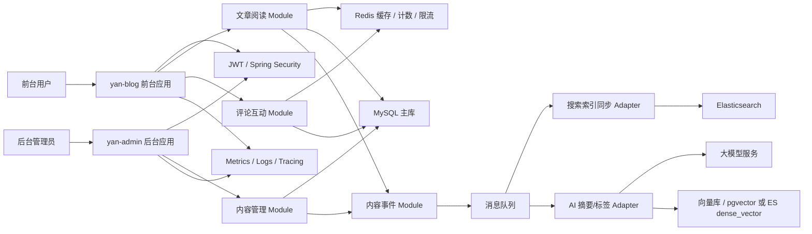

# YanBlog 项目升级规划：从普通博客到高性能智能内容平台

> 生成时间：2026-07-13  
> 规划目标：不改变“博客/内容平台”业务方向，在现有 YanBlog 基础上补齐高并发、搜索、异步、AI、安全、测试与压测证据，使项目能作为后端简历中的高技术水平项目讲清楚。

## 1. 当前项目体检结论

### 1.1 已有基础

YanBlog 当前是一个多模块 Spring Boot 项目：

| Module | 作用 | 当前观察 |
|---|---|---|
| `yan-framework` | 公共领域、Mapper、业务实现、配置、工具类 | 代码最多，包含实体、MyBatis-Plus、Redis、Security、JWT、AOP 日志、OSS、异常处理 |
| `yan-blog` | 前台博客应用 | 文章列表、文章详情、热门文章、评论、登录、用户信息、上传、浏览量定时同步 |
| `yan-admin` | 后台管理应用 | 文章发布、分类、标签、后台登录、权限控制 |

已有技术栈：

- Java 17
- Spring Boot 3.5.6
- Spring Security
- JWT
- MyBatis-Plus
- MySQL
- Redis
- Spring AOP
- SpringDoc OpenAPI
- Aliyun OSS
- EasyExcel

已有可升级亮点：

- `ArticleServiceImpl#updateViewCount` 已经把文章浏览量写入 Redis。
- `UpdateViewCountJob` 已经定时把 Redis 浏览量同步到 MySQL。
- `ViewCountRunner` 已经在应用启动时把 MySQL 文章浏览量加载到 Redis。
- `SecurityConfig`、`JwtAuthenticationTokenFilter`、`LoginServiceImpl`、`BlogLoginServiceImpl` 已经有 JWT 登录认证基础。
- `MenuServiceImpl`、`RoleServiceImpl` 已经有后台菜单/角色权限雏形。
- `LogAspect` 已经有基于注解的接口日志切面。
- `GlobalExceptionHandler` 已经有统一异常返回。

这些基础说明：项目不是空壳，可以在原业务上自然升级成“高性能智能博客内容平台”。

### 1.2 当前短板

| 类型 | 问题 | 对简历/面试的影响 |
|---|---|---|
| 工程可信度 | 缺少 README、接口说明、初始化 SQL、Docker Compose、环境变量示例 | 面试官难以复现；项目看起来像课程代码 |
| 测试 | `src/test` 下几乎没有业务测试，仅看到 `OSSTest` | 很难证明改动正确，压测数据也缺少基线 |
| 配置安全 | `application.yml` 中存在数据库/Redis 明文连接信息 | 简历项目前需要清理，否则是明显安全扣分点 |
| 缓存设计 | 浏览量用了 Redis，但文章详情、热门文章、分类标签等仍主要查库 | “高并发”证据不足 |
| 浏览量同步 | Redis 定时全量同步 MySQL，缺少异常处理、脏数据标记、并发写入说明 | 可以讲思路，但还不够工程化 |
| 查询性能 | 评论树存在根评论循环查子评论的模式，容易出现 N+1 查询 | 高并发评论列表场景容易被追问 |
| 权限深度 | 有 RBAC 雏形，但权限查询、缓存、前后台隔离还不完整 | 可以作为基础，不宜夸大 |
| 搜索能力 | 没有全文检索，文章搜索若用数据库 LIKE 会比较普通 | 缺少内容平台的强亮点 |
| 异步能力 | 除定时任务外，缺少消息队列/事件驱动 | “削峰、解耦、失败重试”不好讲 |
| AI 能力 | 当前没有 AI 摘要、标签推荐、站内问答 | 与当前求职热点 AI 应用结合不足 |
| 可观测性 | 没有 Actuator/Micrometer/Grafana/k6 压测记录 | 不能写真实 QPS、P95 延迟、错误率 |

## 2. 项目升级定位

不建议把博客硬改成健康、商城或运维系统。最自然的升级定位是：

> **高性能智能博客内容平台**

项目描述可以写成：

> 基于 Spring Boot 的前后台分离博客内容平台，支持文章发布、分类标签、评论互动、权限管理、OSS 文件上传、全文搜索、热门内容缓存、异步索引同步、AI 摘要与站内问答。围绕热门文章访问、评论互动、文章检索和 AI 调用等场景进行缓存、限流、异步化、幂等和可观测性优化，并通过压测验证优化效果。

这个定位的好处：

1. 不改业务主线，仍然是博客项目。
2. 能自然解释高并发场景：热门文章、浏览量、评论、搜索、登录、AI 调用。
3. 能体现后端能力：Redis、MySQL、Spring Security、消息队列、Elasticsearch、AI/RAG、监控压测。
4. 与 OpsPilot 不冲突：OpsPilot 是 AI 运维诊断；YanBlog 是高性能内容平台，可以形成两个方向不同的简历项目。

## 3. 总体升级路线

建议分 6 个阶段推进。

| 阶段 | 名称 | 目标 | 是否必须 |
|---|---|---|---|
| Phase 0 | 工程安全与可复现基线 | 清理配置风险，补 README、SQL、Docker Compose、测试基线 | 必须 |
| Phase 1 | 热门内容高并发读取优化 | Redis 缓存文章详情、热门文章、分类标签，治理缓存穿透/击穿/雪崩 | 必须 |
| Phase 2 | 高频互动写入优化 | 浏览量、点赞/收藏/评论计数异步聚合落库，补幂等和失败恢复 | 必须 |
| Phase 3 | 全文搜索与索引同步 | 引入 Elasticsearch，实现文章搜索、高亮、排序和异步索引同步 | 强烈建议 |
| Phase 4 | AI 内容增强 | AI 摘要、标签推荐、站内 RAG 问答，回答关联原文引用 | 可选加分 |
| Phase 5 | 可观测性与压测交付 | Actuator/Micrometer/Grafana/k6，产出真实压测报告 | 必须 |

优先级建议：

1. 先做 Phase 0、1、2、5，形成“高并发博客平台”的可信闭环。
2. 再做 Phase 3，让项目从普通博客升级为“内容检索平台”。
3. 最后做 Phase 4，把 AI 作为增强项，不要让 AI 抢走后端主线。

## 4. 目标架构

关键设计口径：

- **文章阅读 Module**：对外提供文章详情、热门文章、列表查询；内部隐藏 Redis 缓存、MySQL 回源、缓存重建细节。
- **互动计数 Module**：对外提供浏览/点赞/收藏计数；内部隐藏 Redis 原子计数、脏数据集合、定时批量落库。
- **内容事件 Module**：对外提供“文章已发布/文章已更新/文章已删除”等事件接口；内部隐藏消息队列、重试、死信和补偿逻辑。
- **搜索 Module**：对外提供搜索接口；内部隐藏 ES 查询 DSL、高亮、分页、索引同步。
- **AI 内容 Module**：对外提供摘要、标签推荐、站内问答；内部隐藏 Prompt、RAG、模型限流、降级。

这样设计的重点不是把类拆多，而是把复杂实现藏在更深的 Module 后面，提升调用侧的 Leverage 和维护侧的 Locality。

## 5. 分阶段详细规划

## Phase 0：工程安全与可复现基线

### 目标

让项目从“本地能跑的个人代码”变成“别人可以复现、可以测试、可以压测”的简历项目。

### 当前依据

已观察到：

- 根目录没有 README 和 docs。
- 未发现初始化 SQL。
- 业务测试几乎为空。
- 配置文件中存在明文数据库/Redis 连接信息。
- 当前工作区已有未提交改动，应避免覆盖。

### 计划改动

1. 新增 `README.md`
   - 项目定位
   - 技术栈
   - 模块说明
   - 本地启动方式
   - 接口文档地址
   - 演示账号说明
   - 已验证能力与未验证能力

2. 新增 `docs/architecture.md`
   - 当前多模块结构
   - 前台、后台、公共层关系
   - 数据流说明
   - 缓存、搜索、异步、AI 的演进路线

3. 新增 `docs/runbook-local.md`
   - JDK、Maven、MySQL、Redis 版本
   - 数据库初始化步骤
   - 常见启动失败排查

4. 新增 `docker-compose.yml`
   - MySQL
   - Redis
   - 后续可追加 Elasticsearch、Kafka/RabbitMQ、Prometheus、Grafana

5. 配置安全改造
   - 将 `application.yml` 中的真实连接信息改为 `${MYSQL_HOST}`、`${MYSQL_PASSWORD}` 等环境变量。
   - 新增 `application-example.yml` 或 README 示例。
   - `.gitignore` 忽略本地私有配置。

6. 补测试基线
   - `ArticleServiceImpl` 单元测试。
   - `CommentServiceImpl` 单元测试。
   - 登录认证过滤器基础测试。
   - MyBatis/Redis 集成测试可后置到 Testcontainers。

### 验收标准

- `mvn test` 至少能跑通一组核心单元测试。
- 本地不依赖写死的个人数据库/Redis 地址。
- README 可以让别人按步骤启动项目。
- 不在简历中声称任何未压测数据。

### 简历价值

这一阶段本身不是最大亮点，但它决定项目是否“可信”。面试时可以讲：

> 我先把项目从课程式代码整理成可复现工程，补齐配置隔离、启动文档、测试基线和本地依赖编排，后续所有性能优化都基于可重复验证环境进行。

## Phase 1：热门内容高并发读取优化

### 目标

解决热门文章、文章详情、分类标签等高频读取接口在并发访问下反复打 MySQL 的问题。

### 当前依据

相关文件：

- `yan-framework/src/main/java/com/yan/service/impl/ArticleServiceImpl.java`
- `yan-blog/src/main/java/com/yan/controller/ArticleController.java`
- `yan-framework/src/main/java/com/yan/service/impl/CategoryServiceImpl.java`
- `yan-framework/src/main/java/com/yan/service/impl/TagServiceImpl.java`
- `yan-framework/src/main/java/com/yan/utils/RedisCache.java`

当前 `hotArticleList()` 每次仍会查 MySQL 热门文章，再从 Redis 补浏览量。`getArticleDetail()` 每次也会先查 MySQL。

### 计划改动

1. 文章详情缓存
   - Key：`blog:article:detail:{articleId}`
   - 缓存内容：`ArticleDetailVo`
   - 更新/删除文章时主动删除缓存
   - 缓存空值防穿透

2. 热门文章缓存
   - Key：`blog:article:hot:list`
   - 缓存内容：前 10 篇热门文章 VO
   - TTL 加随机扰动，避免同一时间过期
   - 后续可由定时任务或事件驱动刷新

3. 分类/标签缓存
   - Key：`blog:category:list`
   - Key：`blog:tag:list`
   - 后台新增、修改、删除时主动失效

4. 缓存击穿防护
   - 对热点文章详情使用 Redis `SETNX` 互斥锁。
   - 拿不到锁的请求短暂等待后重读缓存。
   - 锁必须设置过期时间，避免死锁。

5. 缓存雪崩防护
   - TTL 增加随机值。
   - 对不同业务 Key 设置不同过期区间。

6. 缓存穿透防护
   - 对不存在文章缓存短 TTL 空值。
   - 可选：文章 ID 规模稳定后引入 Bloom Filter。

### 不建议一开始做的事

- 不建议直接引入复杂本地缓存 + Redis 多级缓存。当前项目体量下先把 Redis 策略讲清楚更重要。
- 不建议一开始就写“百万 QPS”。必须等 Phase 5 压测后再写真实数字。

### 验收标准

- 单元测试覆盖缓存命中、缓存未命中、空值缓存、缓存失效。
- 集成测试验证后台更新文章后，前台详情缓存被删除或重建。
- k6 压测对比：
  - 无缓存文章详情接口
  - Redis 缓存文章详情接口
  - 记录 QPS、P95、MySQL 查询次数变化

### 简历表达

> 针对热门文章高并发访问场景，引入 Redis 缓存文章详情、热门文章和分类标签，并通过空值缓存、互斥锁和随机 TTL 解决缓存穿透、击穿与雪崩问题，降低 MySQL 查询压力。

## Phase 2：高频互动写入优化

### 目标

把浏览量、点赞数、收藏数、评论数这类高频互动写入从“每次请求直接写库”升级为“Redis 原子计数 + 异步批量落库 + 幂等防重”。

### 当前依据

已有浏览量链路：

- `ArticleController#updateViewCount`
- `ArticleServiceImpl#updateViewCount`
- `RedisCache#incrementCacheMapValue`
- `UpdateViewCountJob#updateViewCount`
- `ViewCountRunner#run`

这是很好的并发优化入口，但目前还比较粗糙。

### 计划改动

1. 抽出互动计数 Module
   - 当前浏览量逻辑散落在文章服务、定时任务、启动加载器里。
   - 建议新增类似 `ArticleCounterService` 的深 Module。
   - 对外 Interface 保持简单：
     - `increaseViewCount(articleId, visitorId/requestId)`
     - `getViewCount(articleId)`
     - `flushDirtyCounters()`

2. Redis Hash + 脏数据 Set
   - 浏览量 Hash：`blog:article:view-count`
   - 脏文章 Set：`blog:article:view-count:dirty`
   - 每次增长浏览量时：
     - `HINCRBY blog:article:view-count articleId 1`
     - `SADD blog:article:view-count:dirty articleId`
   - 定时任务只同步 dirty set 中的文章，避免每次全量扫描。

3. 幂等防刷
   - Key：`blog:article:viewed:{articleId}:{fingerprint}`
   - TTL：例如 30 分钟或 1 小时。
   - 同一用户/同一 IP/同一浏览器指纹短时间重复访问只计一次。
   - 未登录用户可以用 IP + User-Agent 哈希，但要承认它不是绝对准确。

4. 批量落库
   - 定时任务每次最多处理 N 个 dirty articleId。
   - 使用 MyBatis-Plus 批量更新。
   - 失败时不要删除 dirty 标记，下次继续重试。

5. 应用关闭前刷盘
   - 可选实现 `@PreDestroy` 或监听 Spring 关闭事件。
   - 尽量减少 Redis 中已计数但 MySQL 尚未同步的窗口。

6. 扩展点赞/收藏
   - 如果当前项目还没有点赞/收藏，可以作为后续功能。
   - 不建议为了简历一次性加太多互动功能，优先把浏览量做深。

### 验收标准

- 并发测试：多个线程同时增加同一文章浏览量，Redis 计数准确。
- 定时同步测试：dirty set 中的文章被批量同步到 MySQL。
- 失败恢复测试：数据库更新失败时 dirty 标记不丢失。
- 幂等测试：同一 fingerprint 在 TTL 内重复请求只计一次。

### 简历表达

> 将文章浏览量等高频计数从同步写库改造为 Redis 原子计数 + dirty set + 定时批量落库，并通过请求指纹与 TTL 实现短时间幂等防刷，降低热点文章访问下的 MySQL 写压力。

## Phase 3：全文搜索与索引同步

### 目标

让博客从普通 CRUD 项目升级为内容平台：支持文章标题、摘要、正文、标签、分类的全文搜索、高亮展示和排序。

### 推荐技术

- Elasticsearch 8.x
- IK 分词器可选
- 如果部署复杂，也可以先使用 Meilisearch，但简历后端通用度不如 Elasticsearch

### 计划改动

1. 新增搜索 Module
   - Interface：
     - `searchArticles(keyword, pageNum, pageSize, sort)`
     - `indexArticle(articleId)`
     - `deleteArticleIndex(articleId)`
   - 对外隐藏 ES 查询 DSL。

2. 建立文章索引
   - 字段：
     - `id`
     - `title`
     - `summary`
     - `content`
     - `categoryId`
     - `categoryName`
     - `tagIds`
     - `tagNames`
     - `viewCount`
     - `createTime`
     - `status`
   - 搜索只检索已发布、未删除文章。

3. 搜索能力
   - 多字段匹配：标题权重最高，摘要其次，正文最低。
   - 高亮：标题、摘要。
   - 排序：
     - 相关度排序
     - 最新排序
     - 热度排序

4. 索引同步
   - 后台发布/更新/删除文章后，发送“文章变更事件”。
   - 消费者异步更新 ES 索引。
   - 失败后重试。
   - 保留一个后台补偿接口：按文章 ID 重建索引，或全量重建索引。

5. 一致性策略
   - MySQL 是事实来源。
   - ES 是搜索视图，允许短暂延迟。
   - 搜索结果点击文章详情时仍以 MySQL/Redis 详情为准。

### 消息队列选择

建议二选一：

| 方案 | 优点 | 缺点 | 建议 |
|---|---|---|---|
| RabbitMQ | 简单、适合任务队列、学习成本低 | 大数据流式能力不如 Kafka | 博客项目更推荐 |
| Kafka | 简历辨识度高、吞吐强、适合事件流 | 部署和解释成本更高 | 如果你想和 OpsPilot 技术栈呼应，可选 |

如果目标是“更稳地完成简历项目”，优先 RabbitMQ。  
如果目标是“和 OpsPilot 一起展示 Kafka 能力”，可以选 Kafka，但要保证能讲清楚分区、消费组、重试和死信。

### 验收标准

- 文章发布后，搜索能查到。
- 文章更新后，搜索展示新标题/摘要。
- 文章删除或下架后，搜索不可见。
- ES 暂时不可用时，文章发布主流程不失败，可记录待补偿任务。
- 压测对比 MySQL LIKE 与 ES 搜索延迟。

### 简历表达

> 引入 Elasticsearch 构建文章全文检索能力，支持标题、摘要、正文、标签多字段搜索与关键词高亮；通过文章变更事件异步同步索引，并以 MySQL 作为事实来源保障最终一致性。

## Phase 4：AI 内容增强

### 目标

在不改变博客业务的前提下，加入 AI 应用亮点：文章摘要、标签推荐、站内内容问答。

### 推荐能力

1. AI 摘要生成
   - 后台发布文章时异步生成摘要。
   - 管理员可编辑模型生成结果。
   - 模型失败不影响文章发布。

2. AI 标签推荐
   - 根据标题和正文推荐 3-5 个标签。
   - 已存在标签优先匹配，避免标签爆炸。
   - 管理员确认后再保存。

3. 站内 RAG 问答
   - 用户可以问：“你这篇博客里怎么理解 Redis 缓存击穿？”
   - 系统先检索相关文章片段，再让大模型基于片段回答。
   - 回答必须附原文标题和片段引用。

### RAG 最小设计

1. 文档来源
   - 已发布文章。
   - 可选：只向量化技术分类文章。

2. 分块策略
   - 按 Markdown 标题和段落分块。
   - 每块保留：
     - `articleId`
     - `title`
     - `section`
     - `chunkIndex`
     - `content`
     - `updateTime`

3. 向量存储
   - 简单路线：pgvector。
   - 如果不想加 PostgreSQL：Elasticsearch dense_vector 也可做演示。
   - 不建议一开始为了博客项目同时上太复杂的向量数据库。

4. 检索策略
   - topK：5
   - 相似度阈值：先用经验值，后续用测试集调参。
   - 没有足够相关片段时，明确返回“站内内容不足”，不要让模型自由发挥。

5. 模型并发控制
   - Redis 用户级限流：每分钟 N 次。
   - JVM 内 Semaphore 限制同时调用模型数量。
   - 超时降级：返回检索到的相关文章，不生成 AI 答案。

### 验收标准

- 发布文章后能生成摘要任务。
- 模型失败不会导致文章发布失败。
- 站内问答答案包含引用来源。
- 无相关内容时不编造答案。
- 有基础评测集：至少 20 个问题，记录命中率和引用准确性。

### 简历表达

> 基于 Spring AI 接入大模型能力，实现文章摘要生成、标签推荐和站内 RAG 问答；通过文章分块、向量检索、引用返回和模型限流降级，提升内容生产效率并降低 AI 幻觉风险。

### 注意

AI 是加分项，不是项目主线。不要在没有评测前写“准确率提升 80%”。可以写“构建了评测集并记录命中率/引用准确性”，数字必须来自真实测试。

## Phase 5：可观测性与压测交付

### 目标

把“我优化了性能”变成“我能用数据证明优化有效”。

### 计划改动

1. Spring Boot Actuator
   - 暴露健康检查。
   - 暴露 JVM、HTTP、线程池、连接池指标。

2. Micrometer + Prometheus + Grafana
   - 监控：
     - HTTP QPS
     - P95/P99 延迟
     - 错误率
     - Redis 命中率
     - MySQL 连接池
     - JVM GC
     - 消息队列堆积
     - AI 调用耗时和失败率

3. 结构化日志
   - 请求 ID / traceId。
   - 慢接口日志。
   - 搜索同步失败日志。
   - AI 调用降级日志。

4. k6 压测脚本
   - `article-detail.js`
   - `hot-article-list.js`
   - `comment-list.js`
   - `search.js`
   - `ai-qa.js`，如果实现 AI

5. 压测报告
   - `docs/performance-report.md`
   - 记录：
     - 机器环境
     - JDK 版本
     - MySQL/Redis/ES 配置
     - 数据量
     - 并发用户数
     - QPS
     - 平均延迟
     - P95/P99
     - 错误率
     - 优化前后对比

### 验收标准

- 每个简历中的性能数字都能在报告里找到来源。
- 压测脚本可以复跑。
- Grafana 截图或指标导出能证明瓶颈变化。
- 不写未经验证的“提升 80%”“支持百万并发”。

### 简历表达

> 使用 k6 对文章详情、热门文章、评论列表和全文搜索接口进行压测，并结合 Micrometer + Prometheus + Grafana 观测 QPS、P95 延迟、错误率、Redis 命中率和数据库连接池指标，基于实测结果优化缓存策略和慢查询。

## 6. 建议最终简历版本

### 项目名称

**高性能智能博客内容平台（实战项目）——后端开发**

### 项目描述

基于 Spring Boot 的前后台分离博客内容平台，支持文章发布、分类标签、评论互动、权限管理、OSS 文件上传、全文检索、AI 摘要与站内问答等功能。系统围绕热门文章访问、文章检索、高频互动写入和 AI 调用等场景，设计 Redis 缓存、异步索引同步、计数批量落库、限流降级和可观测性压测方案，提升内容平台在并发访问下的稳定性与可维护性。

### 技术栈

Spring Boot｜Spring Security｜JWT｜MyBatis-Plus｜MySQL｜Redis｜Elasticsearch｜RabbitMQ/Kafka｜Spring AI｜Prometheus｜Grafana｜k6｜Aliyun OSS

### 核心职责写法

1. 负责文章阅读链路性能优化，引入 Redis 缓存文章详情、热门文章和分类标签，并通过空值缓存、互斥锁和随机 TTL 解决缓存穿透、击穿与雪崩问题。
2. 将文章浏览量等高频互动计数改造为 Redis 原子计数 + dirty set + 定时批量落库，并基于请求指纹实现短时间幂等防刷，降低热点访问下的 MySQL 写压力。
3. 引入 Elasticsearch 构建文章全文检索能力，支持标题、摘要、正文、标签多字段搜索与高亮展示，并通过文章变更事件异步同步索引。
4. 基于 Spring Security + JWT 实现前后台认证鉴权与 RBAC 权限控制，结合 Redis 登录态、接口限流和评论防刷提升系统安全性。
5. 基于 Spring AI 实现文章摘要、标签推荐和站内 RAG 问答，回答结果关联原文片段，并通过模型并发控制与失败降级避免 AI 调用影响主链路。
6. 使用 k6、Micrometer、Prometheus 和 Grafana 对核心接口进行压测与观测，记录 QPS、P95/P99 延迟、错误率、Redis 命中率和数据库连接池指标。

### 暂时不能写的内容

在没有实测前，不要写：

- “支持百万级并发”
- “QPS 提升 300%”
- “接口延迟降低 80%”
- “AI 准确率达到 90%”
- “零丢失”

可以先写：

- “通过压测对比验证优化效果”
- “基于实测报告记录 QPS、P95 延迟和错误率”
- “采用最终一致性保障索引同步”
- “模型失败时降级返回站内检索结果”

## 7. 推荐实施顺序

### 第 1 周：工程可信度与缓存基础

1. 清理敏感配置，改为环境变量。
2. 补 README、运行手册、架构文档。
3. 加 Docker Compose：MySQL + Redis。
4. 补文章详情、热门文章、分类标签缓存。
5. 补基础单元测试和集成测试。

产出：

- 可复现启动环境。
- 缓存优化第一版。
- 初始测试报告。

### 第 2 周：互动计数与评论查询优化

1. 抽出互动计数 Module。
2. 浏览量改为 Redis Hash + dirty set。
3. 加请求指纹幂等防刷。
4. 定时批量落库只处理 dirty 数据。
5. 优化评论列表 N+1 查询。

产出：

- 高频写入优化闭环。
- 并发计数测试。
- 失败恢复测试。

### 第 3 周：搜索与异步事件

1. 引入 Elasticsearch。
2. 建文章索引 mapping。
3. 实现搜索接口。
4. 引入 RabbitMQ 或 Kafka。
5. 文章发布/更新/删除异步同步索引。
6. 加重试和补偿接口。

产出：

- 全文搜索功能。
- 索引同步链路。
- 搜索压测初版。

### 第 4 周：AI 与可观测性

1. 接入 Spring AI。
2. 实现 AI 摘要和标签推荐。
3. 实现站内 RAG 问答。
4. 加模型调用限流、超时、降级。
5. 接入 Actuator、Prometheus、Grafana。
6. 编写 k6 脚本和性能报告。

产出：

- AI 内容增强能力。
- 可观测性面板。
- 真实压测报告。
- 最终简历描述。

## 8. 面试讲解主线

### 60 秒讲法

YanBlog 最初是一个基础博客项目，包含文章、分类、标签、评论、前后台登录和 OSS 上传。我后续没有改变业务方向，而是把它升级成高性能智能内容平台：首先整理工程配置和启动文档，保证项目可复现；然后围绕热门文章访问设计 Redis 缓存，处理缓存穿透、击穿和雪崩；对浏览量这种高频写入使用 Redis 原子计数和 dirty set，再定时批量同步 MySQL；文章搜索部分引入 Elasticsearch，并通过文章变更事件异步同步索引；最后接入 Spring AI 做文章摘要、标签推荐和站内 RAG 问答，同时用 k6、Prometheus 和 Grafana 对核心接口做压测和观测。这个项目重点体现的是内容平台在并发访问下的缓存、异步、一致性、搜索和 AI 降级设计。

### 高频追问准备

1. **为什么浏览量不直接写 MySQL？**  
   因为热门文章会产生大量重复写入，直接写库会放大行锁和磁盘 IO 压力。Redis 的 `HINCRBY` 是原子操作，适合承接高频计数；MySQL 作为持久化事实来源，通过定时批量落库降低写压力。

2. **Redis 计数丢了怎么办？**  
   当前设计应承认存在 Redis 到 MySQL 的同步窗口。改进方式是 dirty set 标记待同步文章、失败不删除 dirty 标记、应用关闭前尽量刷盘。如果要进一步增强，可以把计数变更写入消息队列或 Redis Stream，但 MVP 阶段先保证可解释和可测试。

3. **缓存击穿怎么处理？**  
   热点文章详情过期时，只允许一个请求通过 Redis `SETNX` 获得重建锁并回源 MySQL，其他请求短暂等待后重读缓存。锁必须设置 TTL，避免服务异常导致死锁。

4. **ES 和 MySQL 数据不一致怎么办？**  
   MySQL 是事实来源，ES 是搜索视图。文章发布、更新、删除后通过事件异步同步 ES，允许短暂延迟；如果同步失败，记录失败事件并支持重试/补偿重建索引。文章详情仍从 MySQL/Redis 读取。

5. **AI 问答怎么避免胡说？**  
   先检索站内文章片段，再把片段作为上下文交给模型。Prompt 明确要求只基于检索内容回答，并返回引用来源。检索不到足够证据时返回“站内内容不足”，而不是让模型自由发挥。

## 9. 风险与边界

1. 技术不要一次性全上。缓存和计数优化是主线，ES 和 AI 是增强。
2. 不要写未经验证的数据。所有 QPS、延迟、提升百分比必须来自压测报告。
3. 不要把 AI 写成“智能推荐系统”或“准确率很高”，除非有评测集。
4. 不要引入复杂微服务。当前项目适合继续保持多模块单体。
5. 不要覆盖当前工作区已有改动，尤其是已经修改的 Java 文件和 `.idea` 文件。

## 10. 下一步建议

建议先执行 Phase 0，并把它拆成 4 个小任务：

1. 新增 README、运行手册和架构文档。
2. 敏感配置迁移到环境变量，补 `application-example.yml`。
3. 新增 Docker Compose：MySQL + Redis。
4. 为文章详情、热门文章、评论列表补最小测试基线。

完成后再进入 Phase 1 的缓存优化。这样后面每个技术亮点都有测试和文档托底，简历更稳，面试也更好讲。
